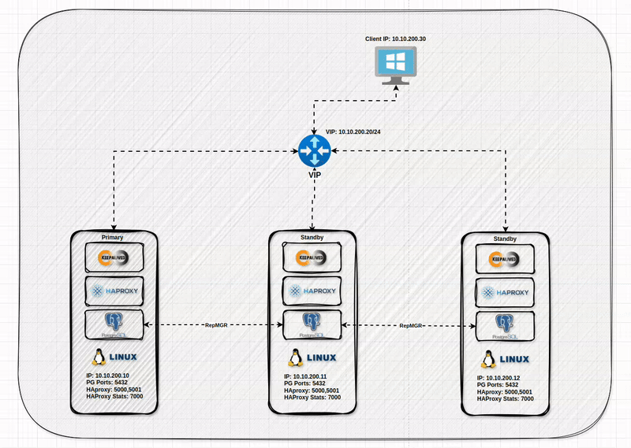

# Setup Postgres Cluster (REPMGR)


## Lab Overview

This lab will help you to setup and configure PostgreSQL 16, repmgr 5.x (`repmgr_16` package), HAProxy and Keepalived on three database nodes to reach PostgreSQL database high availability, plus a fourth node running Barman for backup and Point-In-Time Recovery.

Requirements:
* Oracle Linux 9 ISO [link](https://yum.oracle.com/oracle-linux-isos.html).
* PostgreSQL 16 (this lab was built with 16.2; `dnf` installs the latest 16.x minor release unless you pin the version, e.g. `postgresql16-server-16.2`).
* repmgr 5.x built for PostgreSQL 16 (`repmgr_16` package).
* HAProxy & Keepalived.
* Barman (backup server).
* A client machine to test the connections (Windows in this lab).

| Server      | IP           | PG_Port | VIP          | RO_Port | RW_Port | Role                                      |
| ----------- | ------------ | ------- | ------------ | ------- | ------- | ----------------------------------------- |
| ol9-pg1     | 10.10.200.10 | 5432    | 10.10.200.20 | 5001    | 5000    | PostgreSQL (primary), HAProxy, Keepalived |
| ol9-pg2     | 10.10.200.11 | 5432    | 10.10.200.20 | 5001    | 5000    | PostgreSQL (standby), HAProxy, Keepalived |
| ol9-pg3     | 10.10.200.12 | 5432    | 10.10.200.20 | 5001    | 5000    | PostgreSQL (standby), HAProxy, Keepalived |
| ol9-br1     | 10.10.200.13 | N/A     | N/A          | N/A     | N/A     | Barman backup server                      |
| Win-pg-Clnt | 10.10.200.14 | N/A     | N/A          | N/A     | N/A     | Client                                    |

The VIP `10.10.200.20` uses the hostname `ol9-pg-vip`.

Below is the high level design for the PostgreSQL database cluster:



This diagram shows what the network and the connections between the nodes look like:


## Prepare Nodes VMs

### Create Virtualbox Node Install OL9

Follow this video on my YouTube channel in order to create a VM and setup Oracle Linux 9 server: _TODO: add video link_.

### Clone OL9
Follow this video on my YouTube channel in order to clone the VM. You need 4 VMs in total (3 PostgreSQL nodes + 1 Barman node): _TODO: add video link_.

### Setup Static IP (ALL)

Follow this video on my YouTube channel to assign a static IP address to all nodes (see the table above): _TODO: add video link_.

### Setup Hostname (ALL)

Add the `hostname` you prefer using below command (run the matching command on each node):

```bash
# add hostname
sudo hostnamectl set-hostname ol9-pg1   # on node 1
sudo hostnamectl set-hostname ol9-pg2   # on node 2
sudo hostnamectl set-hostname ol9-pg3   # on node 3
sudo hostnamectl set-hostname ol9-br1   # on the barman node

# add the entries to the hosts file (all nodes)
# note: "sudo echo ... >> /etc/hosts" does not work, the redirect runs without sudo
cat /etc/hosts
echo '10.10.200.10    ol9-pg1'    | sudo tee -a /etc/hosts
echo '10.10.200.11    ol9-pg2'    | sudo tee -a /etc/hosts
echo '10.10.200.12    ol9-pg3'    | sudo tee -a /etc/hosts
echo '10.10.200.13    ol9-br1'    | sudo tee -a /etc/hosts
echo '10.10.200.20    ol9-pg-vip' | sudo tee -a /etc/hosts
cat /etc/hosts
```

### Change Machine ID (Cloned Nodes)

Every cloned VM (ol9-pg2, ol9-pg3 and ol9-br1) needs its own machine ID:

```bash
## Node 2
[admin@ol9-pg2 ~]$ sudo rm -f /etc/machine-id
[admin@ol9-pg2 ~]$ sudo rm -f /var/lib/dbus/machine-id
[admin@ol9-pg2 ~]$ sudo dbus-uuidgen --ensure=/etc/machine-id
[admin@ol9-pg2 ~]$ dbus-uuidgen --get
e5e36d58008875113832db1e665f558f
[admin@ol9-pg2 ~]$ sudo reboot

## Node3
[admin@ol9-pg3 ~]$ sudo rm -f /etc/machine-id
[admin@ol9-pg3 ~]$ sudo rm -f /var/lib/dbus/machine-id
[admin@ol9-pg3 ~]$ sudo dbus-uuidgen --ensure=/etc/machine-id
[admin@ol9-pg3 ~]$ dbus-uuidgen --get
2012976fe5fa19d95ffa08bd665f5596
[admin@ol9-pg3 ~]$ sudo reboot

## repeat the same steps on the barman node (ol9-br1)
```

### Access Nodes using SSH

Follow this video on my YouTube channel in order to forward the ssh port to the host OS, then use any ssh client to access the servers: _TODO: add video link_.

> If you use a VirtualBox NAT adapter for the ssh port forwarding, check which network interface holds the `10.10.200.x` address (`ip -br a`); you will need it later for the Keepalived configuration.

## Install & Configure PostgreSQL

### Install PostgreSQL (ALL)

```bash
# Install the repository RPM:
sudo dnf install -y https://download.postgresql.org/pub/repos/yum/reporpms/EL-9-x86_64/pgdg-redhat-repo-latest.noarch.rpm  

# Disable the built-in PostgreSQL module:
sudo dnf -qy module disable postgresql

# Install PostgreSQL:
sudo dnf install -y postgresql16-server
```

### Create New Location (ALL)

```bash
# create new location on all nodes for data directory using root
mkdir -p /u01/pgdata/data
chown -R postgres:postgres /u01
chmod -R 700 /u01/pgdata
```

### Create Systemd Override for PostgreSQL (ALL)

Do **not** edit the package unit file `/usr/lib/systemd/system/postgresql-16.service` directly. It belongs to the `postgresql16-server` package and is replaced every time you patch PostgreSQL (`dnf update`), which silently resets `PGDATA` back to the default `/var/lib/pgsql/16/data/` and the service no longer finds your data directory. Put the change in a systemd drop-in (override) file under `/etc/systemd/system/` instead; package updates never touch it.

```bash
# create the drop-in directory and the override file
sudo mkdir -p /etc/systemd/system/postgresql-16.service.d
sudo tee /etc/systemd/system/postgresql-16.service.d/override.conf > /dev/null <<'EOF'
[Service]
# Location of database directory (survives package updates)
Environment=PGDATA=/u01/pgdata/data
EOF

# or create the same file interactively (opens an editor on override.conf)
# sudo systemctl edit postgresql-16

# reload systemd and verify the override is applied
sudo systemctl daemon-reload
systemctl cat postgresql-16                    # the override is listed after the package unit file
systemctl show -p Environment postgresql-16    # must include PGDATA=/u01/pgdata/data
```

> Do not start PostgreSQL on the standby nodes: their data directory must stay empty until `repmgr standby clone` fills it.

### Initialize Database (Primary Only)

The `PGDATA` is an environment variable to set PostgreSQL data directory path location, in this setup the location path is `/u01/pgdata/data`. The `postgresql-16-setup` script reads `PGDATA` from the systemd service, so with the override above it initializes the new location:

```bash
# only on primary initialize the database
sudo /usr/pgsql-16/bin/postgresql-16-setup initdb

# enable the service to start automatically and start it (primary only)
sudo systemctl enable --now postgresql-16
sudo systemctl status postgresql-16
```

### Migrate Data to New Location (Optional, Primary Only)

This part is only needed if you already initialized PostgreSQL in the default location (`/var/lib/pgsql/16/data`) before creating the override. If you followed the previous steps, **skip this part**.

**Get Data directory and Config file location (Primary Only)**:

```bash
# get the location of data_directory from postgres
su - postgres
psql
psql (16.2)
postgres=# show config_file;
 /var/lib/pgsql/16/data/postgresql.conf

postgres=# show data_directory;
 /var/lib/pgsql/16/data
```

**Stop Postgres Systemd Service (Primary Only)**

Stop the `postgresql-16` `systemd` service:

```bash
# postgres stop service
sudo systemctl stop postgresql-16.service
```

**Move Data to New Location (Primary Only)**

```bash
su - postgres
rsync -av /var/lib/pgsql/16/data/ /u01/pgdata/data
exit
```

**Point the Service to the New Location (Primary Only)**

Create the override file as described in [Create Systemd Override for PostgreSQL](#create-systemd-override-for-postgresql-all), then start the service:

```bash
sudo systemctl daemon-reload
sudo systemctl enable --now postgresql-16.service
sudo systemctl status postgresql-16.service
```

### Check Configuration Taken (Primary Only)

```bash
su - postgres
psql
postgres=# show config_file;
 /u01/pgdata/data/postgresql.conf

postgres=# show data_directory;
 /u01/pgdata/data
```

### Configure PostgreSQL (Primary Only)

Edit the `postgresql.conf` configuration file: 

```bash
cp /u01/pgdata/data/postgresql.conf /u01/pgdata/data/postgresql.conf.bkp
grep -v '^#' /u01/pgdata/data/postgresql.conf.bkp | grep '^[A-Za-z0-9]' > /u01/pgdata/data/postgresql.conf
chown postgres:postgres /u01/pgdata/data/postgresql.conf

vim /u01/pgdata/data/postgresql.conf
# add below configuration

listen_addresses = '0.0.0.0' # ipv4 only 
max_wal_senders = 10
max_replication_slots = 10
wal_level = 'replica' #  or 'logical'
hot_standby = on
archive_mode = on
archive_command = '/bin/true'
# shared_preload_libraries = 'repmgr'  # enabled after installing repmgr (see "Enable repmgr Library")
wal_log_hints = on                     # required by pg_rewind (repmgr node rejoin --force-rewind)

# restart the service to apply the changes (wal_level and archive_mode need a restart)
sudo systemctl restart postgresql-16
sudo systemctl status postgresql-16
```

### Add Postgres Bin Dir to Postgres User PATH (ALL)

Add the postgres `bin` directory to the `PATH` so you can run command directly from terminal: 

```bash
su - postgres
sed -i "s/PGDATA=.*/PGDATA=\/u01\/pgdata\/data/" .bash_profile
vim .bash_profile
export PATH=/usr/pgsql-16/bin:$PATH
# or 
echo "export PATH=/usr/pgsql-16/bin:\$PATH" >> .bash_profile
exit
```

### Allow Postgres Port on Firewall (ALL)

```bash
# need sudo or root user 
firewall-cmd --add-port=5432/tcp --permanent --zone=public
firewall-cmd --reload
firewall-cmd --list-ports
```

## Install & Configure RepMGR

### Install RepMGR (ALL)

```bash
# install replication manager
sudo dnf install -y repmgr_16
```

### Create Systemd Override for repmgrd (ALL)

Like PostgreSQL, the `/usr/lib/systemd/system/repmgr-16.service` unit file belongs to the `repmgr_16` package and is replaced every time you patch repmgr. Keep your customizations in a drop-in file so they survive the updates:

```bash
sudo mkdir -p /etc/systemd/system/repmgr-16.service.d
sudo tee /etc/systemd/system/repmgr-16.service.d/override.conf > /dev/null <<'EOF'
[Unit]
# start repmgrd after the local PostgreSQL instance
After=postgresql-16.service

[Service]
# repmgr configuration file used by repmgrd (survives package updates)
Environment=REPMGRDCONF=/etc/repmgr/16/repmgr.conf
# restart repmgrd automatically if it crashes
Restart=on-failure
RestartSec=5s
EOF

# reload systemd and verify the override is applied
sudo systemctl daemon-reload
systemctl cat repmgr-16
systemctl show -p Environment repmgr-16    # must include REPMGRDCONF=/etc/repmgr/16/repmgr.conf
```

> The variable name must match the one used by `ExecStart` in the package unit file (`systemctl cat repmgr-16` shows `repmgrd -f ${REPMGRDCONF} ...`). Do not start repmgrd yet; it is started after all nodes are registered.

### Enable repmgr Library (Primary Only)

repmgrd needs the `repmgr` library preloaded by PostgreSQL. Now that `repmgr_16` is installed, uncomment the line in `postgresql.conf` and restart PostgreSQL (the standbys get the same `postgresql.conf` through `repmgr standby clone`):

```bash
sudo sed -i "s/^#\s*shared_preload_libraries.*/shared_preload_libraries = 'repmgr'/" /u01/pgdata/data/postgresql.conf
grep shared_preload_libraries /u01/pgdata/data/postgresql.conf
# shared_preload_libraries = 'repmgr'

sudo systemctl restart postgresql-16
```

### Create RepMGR User & Database (Primary Only)

```bash
su - postgres
createuser -s repmgr
createdb repmgr -O repmgr

# or using psql
su - postgres
psql -c "CREATE USER repmgr WITH SUPERUSER;"
psql -c "CREATE DATABASE repmgr OWNER repmgr;"
```

### Edit PG_HBA File (Primary Only)

Edit the `pg_hba.conf` configuration file. The file is read from top to bottom and the first matching line wins, so add these lines **above** the default entries (otherwise the default `local all all peer` line rejects the local `repmgr` connections):

```bash
vim /u01/pgdata/data/pg_hba.conf
# TYPE  DATABASE        USER            ADDRESS                 METHOD
local   replication     repmgr                                  trust
host    replication     repmgr          10.10.200.0/24          trust
host    replication     repmgr          127.0.0.1/32            trust
local   repmgr          repmgr                                  trust
host    repmgr          repmgr          10.10.200.0/24          trust
host    repmgr          repmgr          127.0.0.1/32            trust

# reload PostgreSQL to apply the changes
sudo systemctl reload postgresql-16
```

### Configure RepMGR (ALL)

Backup the original file:

```bash 
ls -l /etc/repmgr/16/repmgr.conf
mv /etc/repmgr/16/repmgr.conf /etc/repmgr/16/repmgr.conf.bkp
```

#### On primary

You need to make sure that below parameters have correct value to do so you need to edit below parameters accordingly:
* node_id
* node_name
* conninfo
* data_directory
* pg_bindir
* promote_command
* follow_command
* repmgrd_service_start_command
* repmgrd_service_stop_command
* service_start_command
* service_stop_command
* service_restart_command
* service_reload_command

**Simple Config**:

```bash
vim /etc/repmgr/16/repmgr.conf
node_id=1
node_name=ol9-pg1
conninfo='host=ol9-pg1 user=repmgr dbname=repmgr connect_timeout=2'
data_directory='/u01/pgdata/data'
failover=automatic
promote_command='/usr/pgsql-16/bin/repmgr -f /etc/repmgr/16/repmgr.conf standby promote'
follow_command='/usr/pgsql-16/bin/repmgr -f /etc/repmgr/16/repmgr.conf standby follow --upstream-node-id=%n'
```

**Advanced Config**:

```bash
vim /etc/repmgr/16/repmgr.conf
node_id=1
node_name='ol9-pg1'
conninfo='host=ol9-pg1 port=5432 user=repmgr dbname=repmgr connect_timeout=2'
data_directory='/u01/pgdata/data' ## change this to your data directory
pg_bindir='/usr/pgsql-16/bin/'
ssh_options='-q -o ConnectTimeout=10'
failover=automatic
promote_command='/usr/pgsql-16/bin/repmgr standby promote -f /etc/repmgr/16/repmgr.conf --log-to-file'
follow_command='/usr/pgsql-16/bin/repmgr standby follow -f /etc/repmgr/16/repmgr.conf --log-to-file --upstream-node-id=%n'
use_replication_slots=true
connection_check_type='ping'
log_file='/var/log/repmgr/repmgr.log'
monitoring_history=yes
log_status_interval=60
primary_visibility_consensus=true
repmgrd_service_start_command='sudo /usr/bin/systemctl start repmgr-16.service'
repmgrd_service_stop_command='sudo /usr/bin/systemctl stop repmgr-16.service'
service_start_command='sudo /usr/bin/systemctl start postgresql-16.service'
service_stop_command='sudo /usr/bin/systemctl stop postgresql-16.service'
service_restart_command='sudo /usr/bin/systemctl restart postgresql-16.service'
service_reload_command='sudo /usr/bin/systemctl reload postgresql-16.service'
```

#### On Standby Nodes

**Simple**

```bash
vim /etc/repmgr/16/repmgr.conf
node_id=2
node_name=ol9-pg2
conninfo='host=ol9-pg2 user=repmgr dbname=repmgr connect_timeout=2'
data_directory='/u01/pgdata/data'
failover=automatic
promote_command='/usr/pgsql-16/bin/repmgr -f /etc/repmgr/16/repmgr.conf standby promote'
follow_command='/usr/pgsql-16/bin/repmgr -f /etc/repmgr/16/repmgr.conf standby follow --upstream-node-id=%n'
```

```bash
vim /etc/repmgr/16/repmgr.conf
node_id=3
node_name=ol9-pg3
conninfo='host=ol9-pg3 user=repmgr dbname=repmgr connect_timeout=2'
data_directory='/u01/pgdata/data'
failover=automatic
promote_command='/usr/pgsql-16/bin/repmgr -f /etc/repmgr/16/repmgr.conf standby promote'
follow_command='/usr/pgsql-16/bin/repmgr -f /etc/repmgr/16/repmgr.conf standby follow --upstream-node-id=%n'
```

**Advanced Config**:

```bash
vim /etc/repmgr/16/repmgr.conf
node_id=2
node_name='ol9-pg2'
conninfo='host=ol9-pg2 port=5432 user=repmgr dbname=repmgr connect_timeout=2'
data_directory='/u01/pgdata/data' ## change this to your data directory
pg_bindir='/usr/pgsql-16/bin/'
ssh_options='-q -o ConnectTimeout=10'
failover=automatic
promote_command='/usr/pgsql-16/bin/repmgr standby promote -f /etc/repmgr/16/repmgr.conf --log-to-file'
follow_command='/usr/pgsql-16/bin/repmgr standby follow -f /etc/repmgr/16/repmgr.conf --log-to-file --upstream-node-id=%n'
use_replication_slots=true
connection_check_type='ping'
log_file='/var/log/repmgr/repmgr.log'
monitoring_history=yes
log_status_interval=60
primary_visibility_consensus=true
repmgrd_service_start_command='sudo /usr/bin/systemctl start repmgr-16.service'
repmgrd_service_stop_command='sudo /usr/bin/systemctl stop repmgr-16.service'
service_start_command='sudo /usr/bin/systemctl start postgresql-16.service'
service_stop_command='sudo /usr/bin/systemctl stop postgresql-16.service'
service_restart_command='sudo /usr/bin/systemctl restart postgresql-16.service'
service_reload_command='sudo /usr/bin/systemctl reload postgresql-16.service'
```

```bash
vim /etc/repmgr/16/repmgr.conf
node_id=3
node_name='ol9-pg3'
conninfo='host=ol9-pg3 port=5432 user=repmgr dbname=repmgr connect_timeout=2'
data_directory='/u01/pgdata/data' ## change this to your data directory
pg_bindir='/usr/pgsql-16/bin/'
ssh_options='-q -o ConnectTimeout=10'
failover=automatic
promote_command='/usr/pgsql-16/bin/repmgr standby promote -f /etc/repmgr/16/repmgr.conf --log-to-file'
follow_command='/usr/pgsql-16/bin/repmgr standby follow -f /etc/repmgr/16/repmgr.conf --log-to-file --upstream-node-id=%n'
use_replication_slots=true
connection_check_type='ping'
log_file='/var/log/repmgr/repmgr.log'
monitoring_history=yes
log_status_interval=60
primary_visibility_consensus=true
repmgrd_service_start_command='sudo /usr/bin/systemctl start repmgr-16.service'
repmgrd_service_stop_command='sudo /usr/bin/systemctl stop repmgr-16.service'
service_start_command='sudo /usr/bin/systemctl start postgresql-16.service'
service_stop_command='sudo /usr/bin/systemctl stop postgresql-16.service'
service_restart_command='sudo /usr/bin/systemctl restart postgresql-16.service'
service_reload_command='sudo /usr/bin/systemctl reload postgresql-16.service'
```


### Register Primary Node (Primary Only)

```bash
# using postgres
su - postgres
repmgr primary register

#using root
sudo -u postgres /usr/pgsql-16/bin/repmgr -f /etc/repmgr/16/repmgr.conf primary register
```

Output


```bash
repmgr cluster show
repmgr cluster event
repmgr cluster crosscheck
```

Output


Output


### Clone & Register Standby Nodes (Standby Only)

```bash
# try the dry run from standby node 
 sudo -u postgres /usr/pgsql-16/bin/repmgr -h ol9-pg1 -U repmgr -d repmgr standby clone --dry-run

# you should receive below message 
INFO: all prerequisites for "standby clone" are met

# clone the primary to standby server
sudo -u postgres /usr/pgsql-16/bin/repmgr -h ol9-pg1 -U repmgr -d repmgr standby clone

# the output 
INFO: executing:
  /usr/pgsql-16/bin/pg_basebackup -l "repmgr base backup"  -D /u01/pgdata/data -h ol9-pg1 -p 5432 -U repmgr -X stream
NOTICE: standby clone (using pg_basebackup) complete
NOTICE: you can now start your PostgreSQL server
HINT: for example: sudo /usr/bin/systemctl start postgresql-16.service
HINT: after starting the server, you need to register this standby with "repmgr standby register"
```

Start Postgres service on standby server

```bash
# start the service and enable the service
sudo systemctl enable --now postgresql-16

# register the standby
su - postgres
repmgr standby register

# output
NOTICE: standby node "ol9-pg2" (ID: 2) successfully registered
```

### Passwordless SSH connectivity (ALL)

Every node must reach every other node as `postgres` without a password (needed by `repmgr standby switchover --siblings-follow`):

```bash
# all nodes create a ssh key
su - postgres
ssh-keygen -t ed25519
exit

# using root user on all nodes: set a temporary password for ssh-copy-id
passwd postgres

# use copy id on all nodes (full mesh)
# node 1
su - postgres
ssh-copy-id postgres@ol9-pg2
ssh-copy-id postgres@ol9-pg3

# node 2
su - postgres
ssh-copy-id postgres@ol9-pg1
ssh-copy-id postgres@ol9-pg3

# node 3
su - postgres
ssh-copy-id postgres@ol9-pg1
ssh-copy-id postgres@ol9-pg2

# test from every node, it must not ask for a password
ssh ol9-pg1 hostname; ssh ol9-pg2 hostname; ssh ol9-pg3 hostname

# using root lock the password again (key based ssh keeps working)
# do not use "passwd -d": an empty password may allow any local user to "su - postgres"
passwd -l postgres
```

### Grant PostgreSQL Privilege to control services (ALL) 

```bash
# add below file to sudoers using root  
sudo visudo -f /etc/sudoers.d/postgres

# Allow postgres user to manage postgresql-16.service
postgres ALL=(ALL) NOPASSWD: /usr/bin/systemctl start postgresql-16.service, \
                               /usr/bin/systemctl stop postgresql-16.service, \
                               /usr/bin/systemctl reload postgresql-16.service, \
                               /usr/bin/systemctl restart postgresql-16.service, \
                               /usr/bin/systemctl status postgresql-16.service

# Allow postgres user to manage repmgr-16.service
postgres ALL=(ALL) NOPASSWD: /usr/bin/systemctl start repmgr-16.service, \
                               /usr/bin/systemctl stop repmgr-16.service, \
                               /usr/bin/systemctl reload repmgr-16.service, \
                               /usr/bin/systemctl restart repmgr-16.service, \
                               /usr/bin/systemctl status repmgr-16.service


# Not secure : add postgres to wheel group 
sudo usermod -aG wheel postgres
visudo
##### comment and uncomment similar to below editing
## Allows people in group wheel to run all commands
# %wheel        ALL=(ALL)       ALL

## Same thing without a password
%wheel  ALL=(ALL)       NOPASSWD: ALL

# you can remove postgres from wheel group 
# check the groups 
groups postgres

gpasswd -d postgres wheel 


```


### Start RepMGR Service (ALL)

```bash
sudo systemctl enable --now repmgr-16
systemctl status repmgr-16
```

### Patching PostgreSQL & RepMGR (ALL)

Because the custom settings (`PGDATA`, `REPMGRDCONF`, ...) live in drop-in files under `/etc/systemd/system/`, a `dnf update` of `postgresql16*` or `repmgr_16` replaces the package unit files but keeps your overrides. Patch one node at a time (standbys first, then switchover and patch the old primary) and verify the overrides after each update:

```bash
# pause automatic failover during the maintenance (as postgres, from any node)
repmgr service pause

# patch the node
sudo dnf update -y 'postgresql16*' repmgr_16

# make systemd load the new unit files and check the overrides are still applied
sudo systemctl daemon-reload
systemd-delta --type=extended | grep -E 'postgresql-16|repmgr-16'
systemctl show -p Environment postgresql-16   # must include PGDATA=/u01/pgdata/data
systemctl show -p Environment repmgr-16       # must include REPMGRDCONF=/etc/repmgr/16/repmgr.conf

# restart the services on the patched node
sudo systemctl restart postgresql-16
sudo systemctl restart repmgr-16

# check the cluster, then resume automatic failover
repmgr cluster show
repmgr service unpause
```

### RepMGR Commands

You can find all the commands under this [link](https://www.repmgr.org/docs/current/index.html)


## Scenarios & Test-Cases 

### Test Replication

```bash
# connect to secondary and check 
# first Secondary 
[postgres@ol9-pg2 ~]$ psql 'host=ol9-pg2 port=5432 user=repmgr dbname=repmgr connect_timeout=2'
\l
# second Secondary 
[postgres@ol9-pg3 ~]$ psql 'host=ol9-pg3 port=5432 user=repmgr dbname=repmgr connect_timeout=2'
\l

# create a database on primary 
su - postgres 
createdb testdb

# Check secondaries again by running below psql command 
\l

# then cleanup the database by running this command 
dropdb testdb 

```

### Test Switchover 

```bash
# monitor all the repmgr.log on all nodes 
tail -f /var/log/repmgr/repmgr.log

# from standby server or node 
# --siblings-follow if you have more than one standby
repmgr standby switchover --siblings-follow --dry-run 

```

### Test Failover

```bash

# make sure the service ready for automatic failover 
repmgr service status 

# if the pausing is yes make it no 
repmgr service unpause 

# stop service on primary the standby will be promoted
sudo systemctl stop postgresql-16 
```

### Test Rejoin Failed Node

```bash
# on the old (failed) primary, e.g. ol9-pg1 after ol9-pg2 was promoted
# PostgreSQL must be stopped on this node; --force-rewind needs wal_log_hints = on
sudo systemctl stop postgresql-16

# host= must point to the NEW primary (check it with: repmgr cluster show)
repmgr node rejoin -d "host=ol9-pg2 port=5432 user=repmgr dbname=repmgr connect_timeout=2" --force-rewind --verbose --dry-run

# if the dry run is OK, run it without --dry-run
repmgr node rejoin -d "host=ol9-pg2 port=5432 user=repmgr dbname=repmgr connect_timeout=2" --force-rewind --verbose
```

## Setup HAProxy  (ALL)

**HAProxy** (High Availability Proxy) is an open-source software widely used for load balancing and high availability. It is designed to distribute incoming network traffic across multiple backend servers, improving the performance, reliability, and scalability of web applications and services.

**Common Use Cases:**
1. Web Application Load Balancing.
2. API Gateway.
3. Failover and Redundancy.
4. SSL Offloading.
### Install HAProxy (ALL)

```bash
sudo dnf install haproxy
```

Install the PostgreSQL client package if you are setting up HAProxy on servers other than the PostgreSQL servers:

```bash
sudo dnf install -y postgresql16
```

### Configure HAProxy (ALL)

```bash
# backup the original file before we start adding ours.
mv /etc/haproxy/haproxy.cfg /etc/haproxy/haproxy.cfg.orig
```

```bash
su - postgres
psql
```

```sql
CREATE USER haproxy WITH PASSWORD 'mypassword';
GRANT SELECT ON ALL TABLES IN SCHEMA public TO haproxy;
GRANT CONNECT ON DATABASE postgres TO haproxy;
```

Add the `haproxy` user to `pg_hba.conf` on the primary (above the default entries). The HAProxy health check below expects `trust` authentication:

```bash
vim /u01/pgdata/data/pg_hba.conf
host    postgres        haproxy         10.10.200.0/24          trust

# copy pg_hba.conf to the standby nodes (they were cloned before this change), as postgres
scp /u01/pgdata/data/pg_hba.conf ol9-pg2:/u01/pgdata/data/pg_hba.conf
scp /u01/pgdata/data/pg_hba.conf ol9-pg3:/u01/pgdata/data/pg_hba.conf

# reload PostgreSQL on all nodes
sudo systemctl reload postgresql-16.service
ssh ol9-pg2 sudo systemctl reload postgresql-16.service
ssh ol9-pg3 sudo systemctl reload postgresql-16.service
```

```bash
# connect to haproxy user
psql -h ol9-pg1 -U haproxy -d postgres
```

To generate a HAProxy configuration file, you can check this GitHub Repo [link](https://github.com/gplv2/haproxy-postgresql) which allow you using python script to create a PostgreSQL HAProxy configuration automatically, below my HAProxy configuration feel free to edit and use it as well:

```bash
sudo vim /etc/haproxy/haproxy.cfg

# add below config to the haproxy.cfg file 

global
		log /dev/log    local0 info alert
		log /dev/log    local1 notice alert
        stats socket /var/lib/haproxy/admin.sock mode 660 level admin expose-fd listeners
        stats timeout 30s
        user haproxy
        group haproxy
        daemon

        # Default SSL material locations
        ca-base /etc/ssl/certs
        crt-base /etc/ssl/private

        # See: https://ssl-config.mozilla.org/#server=haproxy&server-version=2.0.3&config=intermediate
        ssl-default-bind-ciphers ECDHE-ECDSA-AES128-GCM-SHA256:ECDHE-RSA-AES128-GCM-SHA256:ECDHE-ECDSA-AES256-GCM-SHA384:ECDHE-RSA-AES256-GCM-SHA384:ECDHE-ECDSA-CHACHA20-POLY1305:ECDHE-RSA-CHACHA20-POLY1305:DHE-RSA-AES128-GCM-SHA256:DHE-RSA-AES256-GCM-SHA384
        ssl-default-bind-ciphersuites TLS_AES_128_GCM_SHA256:TLS_AES_256_GCM_SHA384:TLS_CHACHA20_POLY1305_SHA256
        ssl-default-bind-options ssl-min-ver TLSv1.2 no-tls-tickets

        # Stuff for ol9-pg
        maxconn 100

defaults
        log     global
        mode    tcp
        retries 2
        option  dontlognull
        timeout connect 4s
        timeout client  30m
        timeout server  30m
        timeout check 5s
#        errorfile 400 /etc/haproxy/errors/400.http
#        errorfile 403 /etc/haproxy/errors/403.http
#        errorfile 408 /etc/haproxy/errors/408.http
#        errorfile 500 /etc/haproxy/errors/500.http
#        errorfile 502 /etc/haproxy/errors/502.http
#        errorfile 503 /etc/haproxy/errors/503.http
#        errorfile 504 /etc/haproxy/errors/504.http


listen stats
        mode http
        bind *:7000
        stats enable
        stats refresh 5s
        stats uri /

frontend frontend_readwrite
         mode tcp
        bind *:5000

        acl pg_single_master nbsrv(backend_readwrite) eq 1
        tcp-request connection reject if !pg_single_master
       default_backend backend_readwrite

frontend frontend_readonly
        mode tcp
        bind *:5001

        default_backend backend_readonly

backend backend_readwrite
        option tcp-check
        tcp-check connect

# user: haproxy
# database: postgres
#
        tcp-check send-binary 00000028                 # packet length     ( 4 bytes )
        tcp-check send-binary 00030000                 # protocol version  ( 4 bytes )
        tcp-check send-binary 7573657200               # "user"            ( 5 bytes )
        tcp-check send-binary 686170726f787900         # "haproxy"         ( 8 bytes )
        tcp-check send-binary 646174616261736500       # "database"        ( 9 bytes )
        tcp-check send-binary 706f73746772657300       # "postgres"        ( 9 bytes )
        tcp-check send-binary 00                       # terminator        ( 1 byte )

# expect: Auth
#
        tcp-check expect binary 52                     # Auth request
        tcp-check expect binary 00000008               # packet length     ( 8 bytes )
        tcp-check expect binary 00000000               # auth response ok

# write: run simple query
# "select pg_is_in_recovery();"
#
        tcp-check send-binary 51                       # simple query
        tcp-check send-binary 00000020                 # packet length     ( 4 bytes)
        tcp-check send-binary 73656c65637420           # "select "         ( 7 bytes )
        tcp-check send-binary 70675f69735f696e5f7265636f7665727928293b    # "pg_is_in_recovery();"  ( 20 bytes )
        tcp-check send-binary 00 # terminator                                 ( 1 byte )


    # write: terminate session
        tcp-check send-binary 58                       # Termination packet
        tcp-check send-binary 00000004                 # packet length: 4 (no body)
    # avoids :  <template1-pgc-2019-01-18 11:23:06 CET>LOG:  could not receive data from client: Connection reset by peer

# expect: Row description packet
#
        tcp-check expect binary 54                         # row description packet (1 byte)
        tcp-check expect binary 0000002a               # packet length: 42 (0x2a)
        tcp-check expect binary 0001                   # field count: 1
        tcp-check expect binary 70675f69735f696e5f7265636f7665727900 # field name: pg_is_in_recovery
        tcp-check expect binary 00000000               # table oid: 0
        tcp-check expect binary 0000                   # column index: 0
        tcp-check expect binary 00000010               # type oid: 16
         tcp-check expect binary 0001                   # column length: 1
        tcp-check expect binary ffffffff               # type modifier: -1
        tcp-check expect binary 0000                   # format: text

# expect: query result data
#
# "f" means node in master mode               66h
# "t" means node in standby mode (read-only)  74h
#
        tcp-check expect binary 44                     # data row packet
        tcp-check expect binary 0000000b               # packet length: 11 (0x0b)
        tcp-check expect binary 0001                   # field count: 1
        tcp-check expect binary 00000001               # column length in bytes: 1
        tcp-check expect binary 66                     # column data, "f"

# write: terminate session
        tcp-check send-binary 58                       # Termination packet
        tcp-check send-binary 00000004                 # packet length: 4 (no body)

        default-server on-marked-down shutdown-sessions

        server ol9-pg1 ol9-pg1:5432 check inter 5000 fastinter 2000 downinter 5000 rise 2 fall 3
        server ol9-pg2 ol9-pg2:5432 check inter 5000 fastinter 2000 downinter 5000 rise 2 fall 3
        server ol9-pg3 ol9-pg3:5432 check inter 5000 fastinter 2000 downinter 5000 rise 2 fall 3

backend backend_readonly
        option tcp-check
        tcp-check connect

# user: haproxy
# database: postgres
#
        tcp-check send-binary 00000028                 # packet length     ( 4 bytes )
        tcp-check send-binary 00030000                 # protocol version  ( 4 bytes )
        tcp-check send-binary 7573657200               # "user"            ( 5 bytes )
        tcp-check send-binary 686170726f787900         # "haproxy"         ( 8 bytes )
        tcp-check send-binary 646174616261736500       # "database"        ( 9 bytes )
        tcp-check send-binary 706f73746772657300       # "postgres"        ( 9 bytes )
        tcp-check send-binary 00                       # terminator        ( 1 byte )

# expect: Auth
#
        tcp-check expect binary 52                     # Auth request
        tcp-check expect binary 00000008               # packet length     ( 8 bytes )
        tcp-check expect binary 00000000               # auth response ok

# write: run simple query
# "select pg_is_in_recovery();"
#
        tcp-check send-binary 51                       # simple query
        tcp-check send-binary 00000020                 # packet length     ( 4 bytes)
        tcp-check send-binary 73656c65637420           # "select "         ( 7 bytes )
    # "pg_is_in_recovery();"
        tcp-check send-binary 70675f69735f696e5f7265636f7665727928293b    #   ( 20 bytes )
        tcp-check send-binary 00 # terminator                                 ( 1 byte )

    # write: terminate session
        tcp-check send-binary 58                       # Termination packet
        tcp-check send-binary 00000004                 # packet length: 4 (no body)
    # avoids :  <template1-pgc-2019-01-18 11:23:06 CET>LOG:  could not receive data from client: Connection reset by peer

# expect: Row description packet
#
        tcp-check expect binary 54                         # row description packet (1 byte)
        tcp-check expect binary 0000002a               # packet length: 42 (0x2a)
        tcp-check expect binary 0001                   # field count: 1
        tcp-check expect binary 70675f69735f696e5f7265636f7665727900 # field name: pg_is_in_recovery
        tcp-check expect binary 00000000               # table oid: 0
        tcp-check expect binary 0000                   # column index: 0
        tcp-check expect binary 00000010               # type oid: 16
        tcp-check expect binary 0001                   # column length: 1
        tcp-check expect binary ffffffff               # type modifier: -1
        tcp-check expect binary 0000                   # format: text

# expect: query result data
#
# "f" means node in master mode               66h
# "t" means node in standby mode (read-only)  74h
#
        tcp-check expect binary 44                     # data row packet
        tcp-check expect binary 0000000b               # packet length: 11 (0x0b)
        tcp-check expect binary 0001                   # field count: 1
        tcp-check expect binary 00000001               # column length in bytes: 1
        tcp-check expect binary 74                     # column data, "t"

# write: terminate session
        tcp-check send-binary 58                       # Termination packet
        tcp-check send-binary 00000004                 # packet length: 4 (no body)

        default-server on-marked-down shutdown-sessions

        server ol9-pg1 ol9-pg1:5432 check inter 5000 fastinter 2000 downinter 5000 rise 2 fall 3
        server ol9-pg2 ol9-pg2:5432 check inter 5000 fastinter 2000 downinter 5000 rise 2 fall 3
        server ol9-pg3 ol9-pg3:5432 check inter 5000 fastinter 2000 downinter 5000 rise 2 fall 3

```

### Configure SELinux for HAProxy (ALL)

```bash
# Option 1 (recommended): keep SELinux enforcing and allow HAProxy to bind/connect to any port
sudo setsebool -P haproxy_connect_any 1
getsebool haproxy_connect_any

# Option 2: set SELinux to permissive
cat /etc/selinux/config
sudo sed -i 's/^SELINUX=.*/SELINUX=permissive/' /etc/selinux/config
sudo setenforce 0
getenforce
```

### Allow HAProxy & Keepalived on Firewall (ALL)

```bash
# need sudo or root user
# HAProxy stats, read-write and read-only ports
firewall-cmd --add-port=7000/tcp --permanent --zone=public
firewall-cmd --add-port=5000/tcp --permanent --zone=public
firewall-cmd --add-port=5001/tcp --permanent --zone=public
# Keepalived VRRP (IP protocol 112); without it every node takes the VIP (split-brain)
firewall-cmd --add-rich-rule='rule protocol value="vrrp" accept' --permanent --zone=public
firewall-cmd --reload
firewall-cmd --list-ports
firewall-cmd --list-rich-rules
```
### Enable & Start Service (ALL)

```bash
systemctl enable --now haproxy
systemctl status  haproxy
```

Open the HAProxy stats page on any node, e.g. http://10.10.200.10:7000 (from the host machine, use port forwarding if you are using a VirtualBox NAT adapter).

## KeepAliveD

Keepalived is an open-source software suite designed to provide high availability (HA) and load balancing for Linux systems. It is commonly used to ensure that network services remain accessible even if one or more servers fail.

Here’s a key components of KeepaliveD:

1. **VRRP (Virtual Router Redundancy Protocol)**.
2. **LVS (Linux Virtual Server)**.
3. **Health Checking**.

The role of Keepalived is crucial for maintaining high availability and ensuring seamless failover. Here's a detailed look at Keepalived's role:

1. High Availability:
	* **Virtual IP Management**
	- **Failover Handling**

### Install Keepalived (ALL)

```bash
sudo dnf install -y keepalived
```

### Configure Keepalived (ALL)

```bash
mv /etc/keepalived/keepalived.conf /etc/keepalived/keepalived.conf.orig
```

We need to get the network details from all the nodes it will help us later on, during our configuration for keepalived service. 

```bash
# try to get the interface name and the IP
ip -br a 
```

> The configuration below uses `enp0s3`; replace it with the interface that holds the `10.10.200.x` address on your nodes.

Start editing the `keepalived` service using the `keepalived.conf` file.

```bash
vim /etc/keepalived/keepalived.conf
```

```bash
# Virtual Router Redundancy Protocol (VRRP)
# === Node 1 
global_defs {
	enable_script_security
	script_user root
}
vrrp_script chk_haproxy {
	script "/usr/bin/systemctl is-active --quiet haproxy" # check if HAProxy is running  
	interval 2 # check every 2 second  
	weight 4 # weight to influence master election  
}  
vrrp_instance vi_pg1 {  
	state MASTER  
	interface enp0s3  
	virtual_router_id 51  
	priority 102  
	advert_int 1  
	unicast_src_ip 10.10.200.10 
	unicast_peer {  
		10.10.200.11
		10.10.200.12 
	}  
	authentication {  
		auth_type PASS  
		auth_pass Password  
	}  
  
	virtual_ipaddress {  
		10.10.200.20/24 
	}
	track_script {  
		chk_haproxy  
	}  
} 
```

```bash
# Virtual Router Redundancy Protocol (VRRP)
#=== Node 2
global_defs {
	enable_script_security
	script_user root
}
vrrp_script chk_haproxy {
	script "/usr/bin/systemctl is-active --quiet haproxy" # check if HAProxy is running  
	interval 2 # check every 2 second  
	weight 4 # weight to influence master election  
}  
vrrp_instance vi_pg1 {  
	state BACKUP  
	interface enp0s3  
	virtual_router_id 51  
	priority 101  
	advert_int 1  
	unicast_src_ip 10.10.200.11  
	unicast_peer {  
		10.10.200.10
		10.10.200.12
	}  
	authentication {  
		auth_type PASS  
		auth_pass Password  
	}  
  
	virtual_ipaddress {  
		10.10.200.20/24 
	}
	track_script {  
		chk_haproxy  
	}	
}
```


```bash

#=== Node 3
global_defs {
	enable_script_security
	script_user root
}
vrrp_script chk_haproxy {
	script "/usr/bin/systemctl is-active --quiet haproxy" # check if HAProxy is running  
	interval 2 # check every 2 second  
	weight 4 # weight to influence master election  
}  
vrrp_instance vi_pg1 {  
	state BACKUP  
	interface enp0s3  
	virtual_router_id 51  
	priority 100 
	advert_int 1  
	unicast_src_ip 10.10.200.12  
	unicast_peer {  
		10.10.200.10
		10.10.200.11  
	}  
  
	authentication {  
		auth_type PASS  
		auth_pass Password  
	}  
	virtual_ipaddress {  
		10.10.200.20/24  
	}
	track_script {  
		chk_haproxy  
	}	 
}  
```

### Test and start Keepalived

```bash
sudo keepalived -t                      # test the configuration
sudo systemctl enable --now keepalived  # enable and start
sudo systemctl status keepalived
```

```bash
# read write connection 5000 is haproxy readwrite backend
psql "host=10.10.200.20 port=5000 user=repmgr dbname=repmgr"
select inet_server_addr();

# read only connection 5001 is haproxy readonly backend
psql "host=10.10.200.20 port=5001 user=repmgr dbname=repmgr"
select inet_server_addr();

```


## Test the High Availability & Fail-Over Scenarios

This diagram shows how HAProxy and Keepalived are configured, so we need to perform a test with many test cases to make sure those configurations meet our expectations and this setup is ready for production.


### Test Switchover Using RepMGR

```bash
repmgr standby switchover --siblings-follow --dry-run 

repmgr standby switchover --siblings-follow 
```


### Test HAProxy

In this test the HAProxy is working fine on the three nodes, the test will be like, connect PostgreSQL servers from all HAProxy and using connection strings and the Port 5000 and 5001 I have scripted the test you need only to change the parameters to fit your environment in case you are using hostnames and ports not similar to what I have.

```bash
# check the /etc/hosts on all nodes that contains the hostname and ip addresses

cat /etc/hosts
```

Create a test user and database on the primary. Use lowercase names: PostgreSQL folds unquoted identifiers to lowercase, and `pg_hba.conf` matches names case-sensitively.

```bash
# using terminal (as postgres)
createuser -P testuser
createdb testdb -O testuser
```

```sql
-- or using psql
-- Step 1: Create a new user
CREATE USER testuser WITH PASSWORD 'Password123';

-- Step 2: Create a new database owned by the user
CREATE DATABASE testdb OWNER testuser;

-- Step 3: Connect to the new database (schema/table grants apply to the current database)
\c testdb

-- Step 4: Grant usage on the public schema (optional)
GRANT USAGE ON SCHEMA public TO testuser;

-- Step 5: Grant all privileges on all tables in the public schema (optional)
GRANT ALL PRIVILEGES ON ALL TABLES IN SCHEMA public TO testuser;
```

add record to `pg_hba.conf` for the `testuser` and `testdb` database

```bash
host    testdb          testuser        10.10.200.0/24          scram-sha-256
```

copy the `pg_hba.conf` to the other nodes:

```bash
scp /u01/pgdata/data/pg_hba.conf ol9-pg2:/u01/pgdata/data/pg_hba.conf

scp /u01/pgdata/data/pg_hba.conf ol9-pg3:/u01/pgdata/data/pg_hba.conf
```

Reload postgreSQL `systemd` service on all nodes:

```bash
systemctl reload postgresql-16.service
```

try to connect to `testdb` using `testuser` 

```bash
psql -h ol9-pg1 -U testuser -d testdb
```

```bash 
#!/bin/bash

# This script checks the reachability of PostgreSQL and HAProxy servers.

# List of PostgreSQL servers (hostname:port)
PG_NODES=(
    "ol9-pg1:5432"
    "ol9-pg2:5432"
    "ol9-pg3:5432"
    "ol9-pg1:5000"
    "ol9-pg2:5000"
    "ol9-pg3:5000"
    "ol9-pg1:5001"
    "ol9-pg2:5001"
    "ol9-pg3:5001"
    "ol9-pg-vip:5432"
    "ol9-pg-vip:5000"
    "ol9-pg-vip:5001"
)

# List of HAProxy servers (hostname:port)
HAPXY_NODES=(
    "ol9-pg1:7000"
    "ol9-pg2:7000"
    "ol9-pg3:7000"
    "ol9-pg-vip:7000"
)

# Function to check reachability of a PostgreSQL server
# Arguments:
#   $1: server - The server address in the format hostname:port
check_pg_server() {
    local server=$1
    local host=$(echo $server | cut -d':' -f1)
    local port=$(echo $server | cut -d':' -f2)

    # Check if the server is reachable using pg_isready
    pg_isready -h $host -p $port > /dev/null 2>&1
    if [ $? -eq 0 ]; then
        echo "[+] Server ($server): Reachable."
    else
        echo "[-] Server ($server): Not Reachable."
    fi
}

# Function to check reachability of an HAProxy server
# Arguments:
#   $1: server - The server address in the format hostname:port
check_haproxy_server() {
    local server=$1
    local host=$(echo $server | cut -d':' -f1)
    local port=$(echo $server | cut -d':' -f2)

    # Check if the server is reachable using /dev/tcp
    (echo > /dev/tcp/$host/$port) > /dev/null 2>&1
    if [ $? -eq 0 ]; then
        echo "[+] HAProxy Server ($server): Reachable."
    else
        echo "[-] HAProxy Server ($server): Not Reachable."
    fi
}

# Main script execution
# Check PostgreSQL servers
echo "Checking PostgreSQL servers..."
for server in "${PG_NODES[@]}"; do
    check_pg_server $server
done

# Check HAProxy servers
echo "Checking HAProxy servers..."
for server in "${HAPXY_NODES[@]}"; do
    check_haproxy_server $server
done

```

### Test Keepalived 

Before we start the `keepalived` testing, we need to know that `keepalived` relies on `haproxy` means that the `keepalived` master server will keep checking the `haproxy` availability constantly. If the `haproxy` is not available, the `keepalived` will fail-over to another  `keepalived` node that has a higher priority weight, and the `haproxy` is available there.


```bash
# 1. find the current Keepalived master (the node that holds the VIP)
ip -br a | grep 10.10.200.20

# 2. watch keepalived on the backup nodes
sudo journalctl -u keepalived -f

# 3. stop HAProxy on the Keepalived master node
sudo systemctl stop haproxy

# 4. the VIP moves to the backup node with the highest priority (ol9-pg2) within a few seconds
ip -br a | grep 10.10.200.20      # run on ol9-pg2
psql "host=10.10.200.20 port=5000 user=repmgr dbname=repmgr" -c "select inet_server_addr();"

# 5. start HAProxy again, the VIP moves back to ol9-pg1 (higher priority)
sudo systemctl start haproxy
```


## BARMAN Backup/Recovery

In this setup I will introduce you with a solution for Performing back up that will allow Point-In-Time Recovery using barman. This part of my documentation taken from this article [link](https://medium.com/@kiwiv/postgresql-replication-backup-with-repmgr-barman-a8098748b98c).

There are several methods for backing a PostgreSQL database up. You can find more information at this [Link](https://www.postgresql.org/docs/16/backup.html) .

- Backup using pg_dump or pg_dumpall: this solution is the most simple of all but doesn’t perform well for large database. It also would not allow you to perform a fine grained backup and you will not be able to recover data that happened *after the backup*. If you backup using a cronjob every night at 4:00 AM, and an accident happen at 4:00 PM the same day, you would have lost 12 hours of data.
- In our case we are interested in **Continuous Archiving and Point-in-Time Recovery (PITR)** which would allow us to recover our database to any point in time. This is obviously a better solution than pg_dump but requires much more knowledge of PostgreSQL and more configuration. It also does not allow to fine tune the backup on a per database basis, the backup happens for the whole cluster and so is the recovery.

### Install Barman on Barman Server

```bash
# PGDG repository (barman and the PostgreSQL 16 client come from it) and EPEL (Python dependencies)
sudo dnf install -y https://download.postgresql.org/pub/repos/yum/reporpms/EL-9-x86_64/pgdg-redhat-repo-latest.noarch.rpm
sudo dnf install -y oracle-epel-release-el9
sudo dnf -qy module disable postgresql
sudo dnf -y install barman barman-cli postgresql16
```

Add the PostgreSQL binary directory to PATH in bash profile:

```bash
# if bash profile is not added run below command using barman 
cp /etc/skel/.bash_profile ~/

# add below line 
echo "export PATH=/usr/pgsql-16/bin:\$PATH" >> ~/.bash_profile

# check the profile content 
cat ~/.bash_profile

source ~/.bash_profile
```

Change the backup Directory on the server to another location:

```bash
sudo mkdir -p /u02/backups
sudo chown -R barman:barman /u02/

# edit the existing barman_home line (do not add a second one)
sudo vim /etc/barman.conf
barman_home = /u02/backups
```

### Add Entry to Host File \[ALL]

```bash
# these entries were already added in the "Setup Hostname" step, verify them on all nodes
cat /etc/hosts

10.10.200.10    ol9-pg1
10.10.200.11    ol9-pg2
10.10.200.12    ol9-pg3
10.10.200.13    ol9-br1
10.10.200.20    ol9-pg-vip
```

### Configure Passwordless Connection \[ALL]

Barman connects to the PostgreSQL nodes as `postgres` (`barman recover --remote-ssh-command`), and the PostgreSQL nodes connect to Barman as `barman` (`barman-wal-restore` / repmgr `barman_host`), so the keys are exchanged in both directions:

```bash
# on barman server using barman user: create a key and show it
ssh-keygen -t ed25519
cat ~/.ssh/id_ed25519.pub

# on each PostgreSQL node using postgres user: paste the barman public key
vim ~/.ssh/authorized_keys
chmod 600 ~/.ssh/authorized_keys

# on each PostgreSQL node using postgres user: show the postgres public key
cat ~/.ssh/id_ed25519.pub

# on barman server using barman user: paste the postgres public keys of the three nodes
vim ~/.ssh/authorized_keys
chmod 600 ~/.ssh/authorized_keys

# test from barman server (barman user)
ssh postgres@ol9-pg1 hostname
ssh postgres@ol9-pg2 hostname
ssh postgres@ol9-pg3 hostname

# test from every PostgreSQL node (postgres user)
ssh barman@ol9-br1 hostname
```


### Create Barman & Streaming_Barman users \[Primary]

Connect to PostgreSQL primary node and create two users as shown below:

```bash
# su - postgres 
repmgr cluster show

# run below to create a users for barman 
createuser -P --replication streaming_barman
createuser -P -s barman
```

### Edit PG_HBA File \[ALL] 

Add two users to all the `pg_hba` files on each node you have, we have three nodes we need to add this to three nodes:

```bash
# add below lines to the pg_hba.conf
vim /u01/pgdata/data/pg_hba.conf
 
host    replication     streaming_barman 10.10.200.0/24         scram-sha-256
host    postgres        barman          10.10.200.0/24          scram-sha-256
```

Copy the `pg_hba.conf` to the other nodes 

```bash
# node 2
scp /u01/pgdata/data/pg_hba.conf ol9-pg2:/u01/pgdata/data/pg_hba.conf

# node 3 
scp /u01/pgdata/data/pg_hba.conf ol9-pg3:/u01/pgdata/data/pg_hba.conf

```

Reload the `systemd` service on all nodes 

```bash
 sudo systemctl reload postgresql-16.service
 ssh ol9-pg2 sudo systemctl reload postgresql-16.service
 ssh ol9-pg3 sudo systemctl reload postgresql-16.service
```

### Add PGPASS to Barman Home \[ALL]

From barman user create a file called `.pgpass`:- 

```bash
vim ~/.pgpass
*:5000:*:barman:Password123
*:5000:*:streaming_barman:Password123
```

Then Change the access permission on `.pgpass` as shown below:

```bash
chmod 0600 .pgpass
```

Then we can test the connection from barman server to PostgreSQL servers by running these commands :

```bash
psql -c 'SELECT version()' -U barman -h 10.10.200.20 -d postgres -p 5000

psql -U streaming_barman -h 10.10.200.20 -p 5000   -c "IDENTIFY_SYSTEM"   replication=1
```

### Configure PostgreSQL Config \[ALL]

On three nodes make sure these parameters are available in `postgresql.conf` file:

```bash
# check config files 
grep -iE '(^wal_le|^max_.*_send|^max_re)' /u01/pgdata/data/postgresql.conf

ssh ol9-pg2 "grep -iE '(^wal_le|^max_.*_send|^max_re)' /u01/pgdata/data/postgresql.conf"

ssh ol9-pg3 "grep -iE '(^wal_le|^max_.*_send|^max_re)' /u01/pgdata/data/postgresql.conf"

wal_level = replica
max_wal_senders = 10
max_replication_slots = 10
```

### Configure Barman Server

I'm using here the connection for `keepalived` VIP and `HAProxy` port.

```bash
# check the content of this file 
vim /etc/barman.d/demobackup1.conf

[DemoBackup1]
active = true
description = "PostgreSQL for Demo Backup Backup Policy"
conninfo = host=ol9-pg-vip port=5000 user=barman dbname=postgres
streaming_conninfo = host=ol9-pg-vip port=5000 user=streaming_barman dbname=replication
backup_directory = /u02/backups/demobackup1
path_prefix = "/usr/pgsql-16/bin"
backup_method = postgres
streaming_archiver = on
slot_name = barman_pg_demo1
create_slot = auto
retention_policy = 'RECOVERY WINDOW OF 10 DAYS'
```


### Check Barman Backup Setup \[ALL]

```bash

# u need to be barman user to run below commands 
su - barman

# you may find some errors don't panic
barman check DemoBackup1

# create slot
barman receive-wal --create-slot DemoBackup1

# check if the slot is created 
barman replication-status DemoBackup1

# create cron to create the slot if not  
barman cron

# check again 
barman replication-status DemoBackup1


# check the status 
barman check DemoBackup1


# switch the wal to backup it 
barman switch-wal --force --archive DemoBackup1

# psql -h ol9-pg-vip -p 5000 -U repmgr -d repmgr
 SELECT * FROM repmgr.nodes;
 SELECT * FROM pg_stat_replication;

# Take a base backup
barman backup DemoBackup1
barman list-backups DemoBackup1
```


### Configure RepMgr with Barman \[ALL]

On three nodes you need to install `barman-cli` (it may need the EPEL repository: `sudo dnf install -y oracle-epel-release-el9`):

```bash
sudo dnf install -y barman-cli
```

Then add the barman settings to `repmgr.conf` and restart repmgrd:

```bash
# add below lines
vim /etc/repmgr/16/repmgr.conf
barman_host='barman@ol9-br1'
barman_server='DemoBackup1'
restore_command='/usr/bin/barman-wal-restore -U barman ol9-br1 DemoBackup1 %f %p'

sudo systemctl restart repmgr-16.service
systemctl status repmgr-16.service
```

### Recover Node From Failure

```bash
# monitor barman backup server 
tail -100f /var/log/barman/barman.log

# monitor standby servers 
tail -f /var/log/repmgr/repmgr.log

# on primary stop postgres to mimic the failure 
sudo systemctl stop postgresql-16.service

# from new primary check the status 
repmgr cluster show

# from failed primary (ol9-pg1), point to the new primary (e.g. ol9-pg2)
repmgr -h ol9-pg2 -U  repmgr -d repmgr -F standby clone --dry-run

# then force the clone (repmgr restores from the barman server set in barman_host)
repmgr -h ol9-pg2 -U  repmgr -d repmgr -F standby clone

# start postgres
sudo systemctl start postgresql-16.service

# register the node as standby 
repmgr standby -F register

# check the cluster
repmgr cluster show

```

#### Crontab

Create the backup script as the `barman` user (home directory `/var/lib/barman`):

```bash
vim ~/DemoBackup1.sh
```

```bash
#!/bin/bash

# Define variables
BACKUP_LOG="/var/log/barman/backup-$(date +%F_%H%M%S).log"
BARMAN_CMD="/usr/bin/barman"
SERVER_NAME="DemoBackup1"

# Perform the backup
$BARMAN_CMD backup $SERVER_NAME --wait > $BACKUP_LOG 2>&1

# Check if the backup was successful
if [ $? -eq 0 ]; then
  echo "$(date '+%F %T'): Backup successful" >> $BACKUP_LOG
else
  echo "$(date '+%F %T'): Backup failed" >> $BACKUP_LOG
fi
```

Make it executable and schedule it in the `barman` user's crontab (every day at midnight):

```bash
chmod +x ~/DemoBackup1.sh

crontab -e

0 0 * * * /var/lib/barman/DemoBackup1.sh
```

#### Client Connection String

Extra connection-string options used by the .NET (Npgsql) client in this lab:

```text
Pooling=false;Timeout=300;CommandTimeout=300;KeepAlive=300;Include Error Detail=True;
```


### Point In Time Recovery

PITR replaces the data directory of the target node and starts a new timeline, so run it on a node that you removed from the repmgr cluster (`repmgr standby unregister`) or on a separate server. Stop PostgreSQL on the target node first:

```bash
# on the target node (ol9-pg3)
sudo systemctl stop postgresql-16
```

From the barman server as `barman` user (list the backup IDs with `barman list-backups DemoBackup1`):

```bash
# recover the latest backup up to a point in time
barman recover --remote-ssh-command="ssh postgres@ol9-pg3" \
--target-time "2024-08-29 11:00" DemoBackup1 latest /u01/pgdata/data
```

```bash
# recover a specific backup
barman recover --remote-ssh-command="ssh postgres@ol9-pg3" \
DemoBackup1 <BackupID> /u01/pgdata/data
```

# Create User

The tablespace directory must exist and be owned by `postgres` on the primary **and on every standby** before you create the tablespace, otherwise WAL replay fails on the standbys:

```bash
# on all PostgreSQL nodes using root
mkdir -p /u01/pgts
chown postgres:postgres /u01/pgts
chmod 700 /u01/pgts
```

```sql
-- on the primary using psql
create tablespace data_tbs location '/u01/pgts';
create user dbuser login superuser password 'dbuser123';
create database db1 owner dbuser tablespace data_tbs;
\c db1
create schema authorization dbuser;
```
